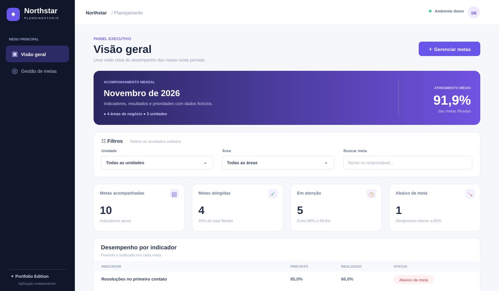

# ✦ Northstar Planning Studio

**Painel de planejamento estratégico e acompanhamento de indicadores**

Aplicação independente de portfólio com **Blazor .NET 9, C#, SQLite e testes automatizados**.

[Funcionalidades](#funcionalidades) · [Executar localmente](#executar-localmente) · [Arquitetura](#arquitetura) · [Testes](#qualidade-e-testes)

> **Prévia ilustrativa** criada a partir da interface demonstrativa. Não substitui uma captura de tela da versão atualizada com histórico e SQLite. Todos os nomes e valores são fictícios.

## O projeto

O Northstar é uma demonstração técnica de uma aplicação de gestão de metas. Foi desenvolvido de forma **independente, do zero**, para demonstrar o desenvolvimento de aplicações corporativas com .NET, Blazor e persistência local. Não inclui código-fonte, banco de dados, regras proprietárias, credenciais ou marcas de empregadores.

O projeto foca em problemas comuns de software de gestão: organização de indicadores, acompanhamento do previsto e realizado, filtros, cálculo coerente de desempenho e experiência de uso responsiva.

## Funcionalidades

| Módulo | O que demonstra |
| --- | --- |
| **Visão geral** | KPIs, acompanhamento de desempenho e status de indicadores |
| **Filtros combinados** | Seleção de período, unidade, área e pesquisa por nome/responsável |
| **Histórico mensal** | Evolução do atingimento médio ao longo de seis meses fictícios |
| **Gestão de metas** | Cadastro validado, atualização do realizado, inativação e reativação |
| **Persistência local** | SQLite, criação automática do esquema e dados iniciais de exemplo |
| **Restauração** | Reposição dos dados demonstrativos com confirmação prévia |
| **Testes** | Regras de cálculo e operações de persistência verificadas com xUnit |

## Tecnologias

- **Backend:** ASP.NET Core 9, C# e componentes Razor interativos.
- **Interface:** HTML semântico e CSS responsivo, sem framework visual pesado.
- **Persistência:** `Microsoft.Data.Sqlite`, comandos SQL parametrizados e banco local.
- **Qualidade:** xUnit e pipeline de build/testes no GitHub Actions.

## Executar localmente

**Requisitos:** SDK [.NET 9](https://dotnet.microsoft.com/en-us/download/dotnet/9.0) e Windows, Linux ou macOS.

Se não tiver o Git instalado, use **Code → Download ZIP** neste repositório e extraia antes de executar os comandos.

~~~powershell
dotnet restore StrategicPlanningDashboard.csproj
dotnet run --project StrategicPlanningDashboard.csproj
~~~

Abra o endereço informado pelo terminal (em geral, `http://localhost:5000`). Para parar, pressione `Ctrl+C`.

Na primeira execução, o aplicativo cria automaticamente `App_Data/northstar.db` e insere dados sintéticos. Nas próximas execuções, as alterações permanecem salvas **na mesma máquina**, até que o banco seja apagado ou os dados sejam restaurados no painel.

> **Atenção:** a aplicação é uma demonstração local, **sem autenticação**. Não a exponha diretamente à internet, pois qualquer visitante teria acesso à gestão de metas e à restauração dos dados.

## Qualidade e testes

~~~powershell
dotnet test tests/StrategicPlanningDashboard.Tests/StrategicPlanningDashboard.Tests.csproj
~~~

O projeto contém testes automatizados de status de metas, consolidação normalizada, cadastro, persistência, inativação e restauração. Na validação local de 23/11/2026 foram executados **10 testes, com 10 aprovações e nenhuma falha**.

O workflow em [GitHub Actions](.github/workflows/build.yml) está configurado para restaurar as dependências, compilar e executar os testes a cada push e pull request. Consulte a aba **Actions** para conferir a execução atual — o resultado local não é um status de CI.

## Arquitetura

~~~text
strategic-planning-dashboard/
├── Components/
│   ├── Layout/                   # Navegação e estrutura
│   └── Pages/                    # Dashboard e gestão de metas
├── Models/                       # Modelo de meta e validação
├── Services/
│   ├── GoalMetrics.cs            # Regras de consolidação
│   └── PlanningStore.cs          # Persistência SQLite e dados de teste
├── tests/                        # xUnit e testes de integração
├── docs/                         # Prévia visual e notas técnicas
├── wwwroot/                      # CSS da interface
└── .github/workflows/            # Build e testes
~~~

**Cálculo:** cada indicador tem previsto e realizado próprios. Para o atingimento individual: `(realizado / previsto) × 100` quando previsto é maior que zero. No resumo agregado, o percentual de cada indicador é limitado a 100% e todos têm o mesmo peso. **Não são somadas diretamente moedas, quantidades e porcentagens diferentes.** O recorte demonstrativo considera que quanto maior o resultado, melhor.

Consulte [Decisões técnicas e limitações](docs/ARCHITECTURE.md) para conhecer o escopo e as escolhas implementadas.

## Imagens do projeto

- [Prévia ilustrativa do dashboard](docs/preview-dashboard.svg).
- Para incluir **capturas reais** da última versão, veja [Guia de capturas](docs/SCREENSHOTS.md). A imagem anterior foi enviada durante os testes da primeira versão, portanto ainda não documenta as novidades desta versão.

## Considerações de segurança

- Dados, responsáveis, unidades e resultados **100% fictícios**.
- Nenhuma integração com sistemas externos, contas ou serviços empresariais.
- Banco local ignorado pelo Git por meio de `.gitignore`.
- Sem login, controle de permissões ou isolamento entre usuários: uso **somente local**.
- A visibilidade do repositório pode ser alterada depois de uma revisão de propriedade intelectual e segurança. **Publicar o código é diferente de hospedar a aplicação** e não requer Railway.

## English overview

**Northstar Planning Studio** is a standalone .NET 9 / Blazor dashboard for managing goals and tracking KPIs. It features responsive UI, combined filters, monthly trend visualization, SQLite persistence, synthetic demo data, and xUnit tests. Built independently as a technical portfolio sample, without proprietary company code or data.

---

Projeto demonstrativo · Desenvolvido para portfólio técnico · Sem hospedagem ou custo mensal

